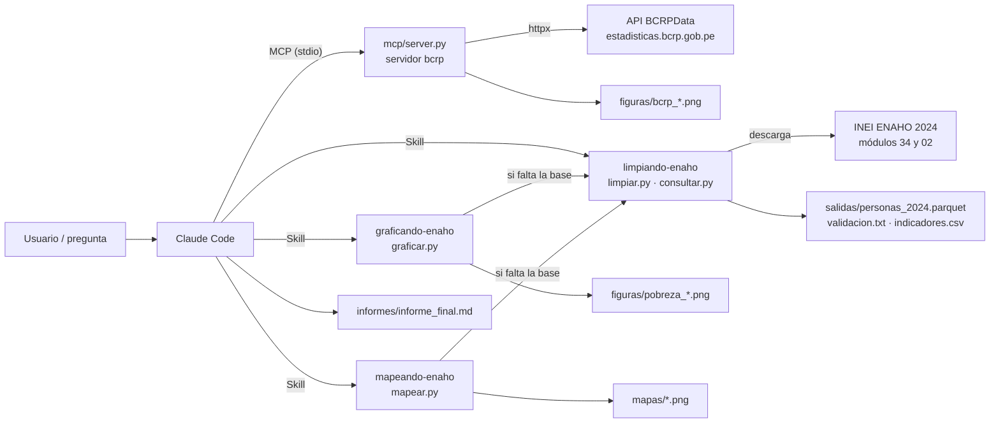
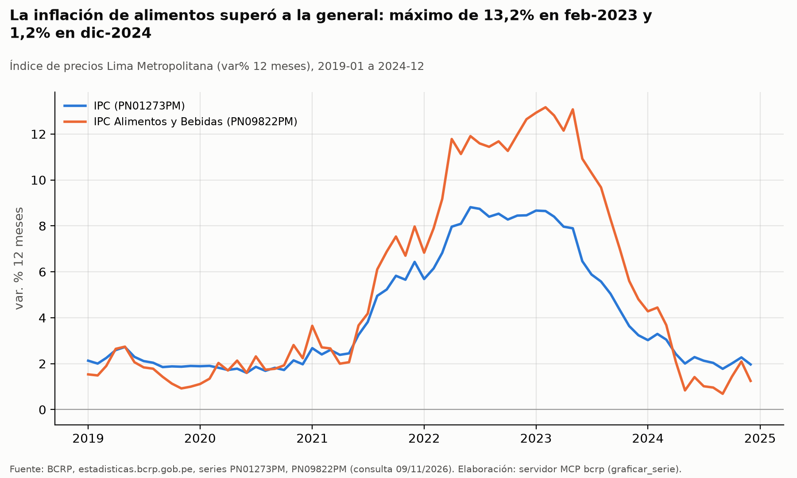
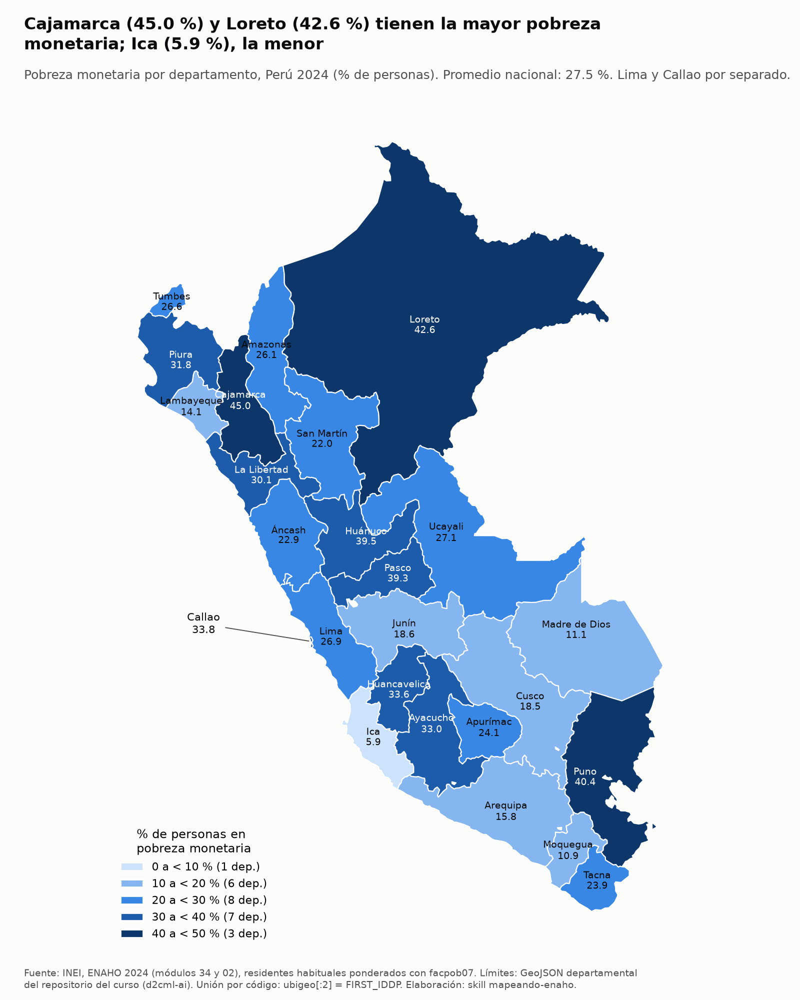

# Agente de investigación socioeconómica del Perú: MCP, Skills y datos oficiales

**Tarea 4 – Python Intermedio.** Claude Code combina un **servidor MCP del BCRP** (series macroeconómicas) con tres **Skills de la ENAHO 2024 del INEI** (microdatos de hogares) para responder una pregunta de investigación con cifras verificables.

| | |
|---|---|
| **Pregunta de investigación** | Después de la recesión de 2020 y del pico inflacionario de 2022, ¿cómo evolucionaron entre 2019 y 2024 la actividad económica y la inflación (en especial la de alimentos), y qué brechas territoriales y socioeconómicas de pobreza monetaria, y de peso de los alimentos en el gasto de los hogares, mostraba el Perú en 2024? |
| **Informe final** | [`informes/informe_final.md`](informes/informe_final.md) · verificación manual en [`informes/verificacion.md`](informes/verificacion.md) |
| **Pruebas MCP** | **10/10** (`mcp/test_server.py`: 8 originales sin cambios + 2 propias) · salida en [`salidas/pruebas_mcp.txt`](salidas/pruebas_mcp.txt) |
| **Validación ENAHO** | Pobreza nacional **27.53 %** con residentes habituales y `facpob07`, y **27.58 %** con el método INEI. Oficial: 27.6 % ± 0.1 · **108,664** residentes · **33,691** hogares · **25** departamentos · **15/15** validaciones ([`salidas/validacion.txt`](salidas/validacion.txt)) |
| **Evaluación A/B** | Sin MCP ni Skills: **2/10** · Con MCP y Skills: **10/10** ([`evaluacion/comparacion.md`](evaluacion/comparacion.md)) |
| **Evidencias de IA** | [`evidencias_ia/`](evidencias_ia/README.md): conversación completa de desarrollo y trazas de cada ejecución del agente |

## Objetivo

Construir un agente que no responda de memoria. Cada cifra debe salir de una herramienta que se pueda volver a ejecutar:

- **BCRP:** las series oficiales se consultan a la API pública con un servidor MCP propio. Las cuentas (promedios, extremos, comparaciones) las hace Python, no el modelo.
- **INEI:** los microdatos de la ENAHO 2024 se limpian, unen, ponderan y validan contra las cifras oficiales con Skills de Claude Code. Las Skills también producen gráficos y un mapa.
- **Integración:** Claude Code coordina ambas fuentes para responder una pregunta que necesita las dos, deja un informe reproducible y se evalúa contra sí mismo sin herramientas.

## Arquitectura



```text
tarea_4/
├── README.md · pyproject.toml · uv.lock · .python-version · .mcp.json · .gitignore
├── mcp/                      server.py (servidor MCP) · test_server.py (10 pruebas) · test_extras.py (2 extra)
├── .claude/skills/
│   ├── limpiando-enaho/      SKILL.md · reference.md · scripts/{limpiar,consultar,estimacion}.py
│   ├── graficando-enaho/     SKILL.md · scripts/graficar.py
│   └── mapeando-enaho/       SKILL.md · scripts/mapear.py · referencias/pobreza_departamento_2024.csv
├── datos/                    (ignorado por git) microdatos INEI, catálogo BCRP y GeoJSON: se descargan solos
├── salidas/                  validacion.txt · indicadores.csv · pruebas_mcp.txt (los .parquet se ignoran)
├── figuras/ · mapas/         gráficos y mapas generados por el MCP y las skills
├── informes/                 pregunta_investigacion.md · informe_final.md · verificacion.md · verificacion_cifras.csv
├── evaluacion/               preguntas.csv · respuestas_esperadas.py · evaluar.py · resultados.csv · revision_manual.csv · comparacion.md
├── scripts/                  ejecutar_agente.py · resumir_traza.py · verificar_informe.py · exportar_conversacion.py · ocultar_evidencias.py
└── evidencias_ia/            mcp/ · skills/ · integracion/ · evaluacion/ (conversación y trazas)
```

## Servidor MCP del BCRP (`mcp/server.py`)

Parte del esqueleto de la sesión 04 (`d2cml-ai/Data-Science-Python`) y está hecho con FastMCP 4. Funciona por stdio.

| Herramienta | Qué hace |
|---|---|
| `buscar_series(texto, frecuencia, limite)` | Busca por palabras clave, sin tildes, en el catálogo oficial (`/metadata`, unas 17 mil series) y devuelve código, nombre, frecuencia, inicio y última actualización. Ordena primero las series vigentes y las más generales. |
| `serie(codigo, desde, hasta)` | Devuelve los datos de una serie diaria, mensual, trimestral o anual, con los períodos normalizados (`2024-12`, `2025-T1`…) y la URL de la API como fuente. Omite los `n.d.` y da un error claro si el código no existe o no hay datos. |
| `resumen(codigo, desde, hasta)` | Calcula primero, último, cambio, variación %, promedio, máximo y mínimo (con su período) y n. |
| **`comparar_periodos(...)`** (propia) | Compara una serie en dos intervalos disjuntos: estadísticas de cada uno, diferencia y variación % de los promedios y cuál es mayor. Valida el orden de las fechas **antes** de descargar y rechaza los intervalos superpuestos. |
| **`graficar_serie(codigos, desde, hasta, titulo, unidad, archivo)`** (propia) | Grafica de 1 a 4 series en un PNG en `figuras/`, con título analítico, período, unidad, paleta validada y nota de fuente con los códigos y la fecha de consulta. |

- **Recursos:** `bcrp://serie/{codigo}` (ficha con enlaces a la página y a la API) y `bcrp://series-clave` (las 8 series del proyecto: IPC, IPC de alimentos, IPC sin alimentos y energía, PBI, tipo de cambio, tasa de referencia y desempleo).
- **Prompts:** `informe(tema)` e `interpretar_indicador(codigo, desde, hasta)`. Los dos piden citar código y período de cada cifra y no atribuir causas.
- **Pruebas:**
  - `uv run pytest mcp/test_server.py -v` → **10 passed**. Las 8 pruebas originales no se modificaron. Las 2 propias prueban `comparar_periodos`: la inflación de 2022 frente a 2024, con el máximo de 8.81 % en jun-2022, y el rechazo de intervalos invertidos, superpuestos y de códigos inexistentes.
  - `mcp/test_extras.py` agrega 2 pruebas más, para `graficar_serie` y el recurso.

## Skills de la ENAHO (`.claude/skills/`)

| Skill | Se activa cuando piden… | Qué hace |
|---|---|---|
| **`limpiando-enaho`** | limpiar, preparar o validar la ENAHO, o cualquier cifra de pobreza o gasto de los hogares | Descarga los módulos 34 (sumaria) y 02 (personas) del INEI. Lee las llaves como texto (`conglome`, `vivienda`, `hogar`, `codperso` y `ubigeo` conservan sus ceros). Filtra a los residentes habituales con `((p204==1)&(p205==2)) \| ((p204==2)&(p206==1))` y une con `validate="m:1"`. Pondera con `facpob07` y calcula errores estándar de diseño (conglomerado `conglome`, estrato `estrato`) con IC 95 %. Aplica **15 validaciones**: las esenciales detienen el proceso y borran la base si fallan. `consultar.py` responde por grupo con IC. |
| **`graficando-enaho`** | graficar o visualizar la pobreza por área, sexo, edad, jefatura, región o departamento | Hace barras horizontales desde cero con IC, línea del promedio nacional y título analítico. Si los IC se superponen, el título lo dice. Lleva subtítulo con período y unidad, y nota de fuente. Guarda PNG y CSV en `figuras/`. |
| **`mapeando-enaho`** | un mapa o la distribución territorial de la pobreza | Une `ubigeo[:2]` con `FIRST_IDDP` del GeoJSON con `validate="1:1"` y exige 25 departamentos, con Lima (15) y Callao (07) separados. Arma un coroplético por clases y lo compara con la referencia de la sesión 16. Guarda en `mapas/`. |

- **Coordinación:** `graficando-enaho` y `mapeando-enaho` buscan primero `salidas/personas_2024.parquet`. Si no existe, invocan `limpiando-enaho` con la herramienta Skill antes de seguir (evidencia: [`evidencias_ia/skills/03_coordinacion_limpieza_y_mapa.md`](evidencias_ia/skills/03_coordinacion_limpieza_y_mapa.md)).
- **Invocación directa:** `/limpiando-enaho 2024` ([evidencia](evidencias_ia/skills/01_invocacion_directa_limpiando.md)).
- **Activación por lenguaje natural:** «Grafica la pobreza monetaria por sexo del jefe de hogar…» activa `graficando-enaho` sin nombrarla ([evidencia](evidencias_ia/skills/02_lenguaje_natural_graficando.md)).

**Dos métodos de estimación.** Los dos están en `salidas/indicadores.csv` y se explican en `reference.md`.

| | Residentes habituales (`facpob07`) | Método INEI (`factor07 × mieperho`) | Oficial INEI |
|---|---|---|---|
| Nacional | 27.53 % | 27.58 % | 27.6 % |
| Urbana / rural | 24.74 % / 39.44 % | 24.81 % / 39.30 % | 24.8 % / 39.3 % |
| Pobreza extrema | 5.50 % | 5.51 % | 5.5 % |
| 25 departamentos frente a la referencia de la sesión 16 | 6/25 iguales, máx. 0.5 pp, correlación de rangos 0.999 | **25/25 iguales** | — |

El método de residentes habituales es el que pide el enunciado. La diferencia de décimas viene de la población contada: los residentes habituales excluyen a 1,787 miembros ausentes e incluyen a 609 no miembros presentes. Sin ponderar, la pobreza saldría 25.61 %, es decir, 1.9 pp menos.

## Datos

| Fuente | Enlace | Uso |
|---|---|---|
| BCRP, API de BCRPData | `https://estadisticas.bcrp.gob.pe/estadisticas/series/api/{codigo}/json/{desde}/{hasta}` · [documentación](https://estadisticas.bcrp.gob.pe/estadisticas/series/ayuda/api) | Series (MCP) |
| BCRP, catálogo de series | `https://estadisticas.bcrp.gob.pe/estadisticas/series/metadata` | `buscar_series`, se guarda en `datos/bcrp/` |
| INEI, ENAHO 2024 (código 966) | [Portal de microdatos](https://proyectos.inei.gob.pe/microdatos/) · `https://proyectos.inei.gob.pe/iinei/srienaho/descarga/STATA/966-Modulo34.zip` y `…/966-Modulo02.zip` | Skills, se guarda en `datos/inei/` |
| Límites departamentales | [`peru_departamental_simple.geojson`](https://raw.githubusercontent.com/d2cml-ai/Data-Science-Python/main/sessions/06-geoespacial/lab/Data/peru_departamental_simple.geojson) (curso, sesión 06) | Mapa, se guarda en `datos/geo/` |
| Referencia departamental 2024 | Sesión 16 del curso → `.claude/skills/mapeando-enaho/referencias/pobreza_departamento_2024.csv` | Validación del mapa |

`datos/` y los `.parquet` no se suben al repositorio: los scripts descargan lo que falte.

## Instalación (uv)

Requisitos: [uv](https://docs.astral.sh/uv/) y [Claude Code](https://docs.claude.com/en/docs/claude-code). Python 3.12 lo instala uv.

```bash
cd tarea_4
```

```bash
uv sync
```

## Conexión del MCP

[`.mcp.json`](.mcp.json) registra el servidor para Claude Code con alcance de proyecto:

```json
{"mcpServers": {"bcrp": {"type": "stdio", "command": "uv", "args": ["run", "python", "mcp/server.py"], "env": {}}}}
```

1. Abran Claude Code **desde `tarea_4/`** (`claude`) y aprueben el servidor `bcrp` cuando lo pida. Hasta entonces, `claude mcp list` lo muestra como «Pending approval».
2. Comprueben con `/mcp` que `bcrp` aparece conectado con 5 herramientas, 2 recursos y 2 prompts.
3. Las skills se cargan solas desde `.claude/skills/`. Con `/` aparecen `limpiando-enaho`, `graficando-enaho` y `mapeando-enaho`.

En modo no interactivo, los scripts del proyecto pasan `--strict-mcp-config --mcp-config .mcp.json`, así que no hace falta aprobarlo.

## Comandos de reproducción

Todos se ejecutan desde `tarea_4/`.

```bash
uv run pytest mcp/test_server.py -v
```

```bash
uv run python .claude/skills/limpiando-enaho/scripts/limpiar.py --anio 2024
```

```bash
uv run python .claude/skills/limpiando-enaho/scripts/consultar.py --por departamento --orden desc
```

```bash
uv run python .claude/skills/graficando-enaho/scripts/graficar.py --todos
```

```bash
uv run python .claude/skills/mapeando-enaho/scripts/mapear.py
```

```bash
uv run python scripts/ejecutar_agente.py --modo mcp_skills --prompt-file informes/pregunta_investigacion.md --salida evidencias_ia/integracion/02_ejecucion_integrada
```

```bash
uv run python scripts/verificar_informe.py
```

```bash
uv run python evaluacion/evaluar.py
```

| Comando | Qué produce |
|---|---|
| `pytest` | Las 10 pruebas del MCP |
| `limpiar.py` | Base limpia + `validacion.txt` + `indicadores.csv` |
| `consultar.py` | Pobreza por departamento con IC 95 % |
| `graficar.py --todos` | Gráficos por área, sexo, departamento y edad × área |
| `mapear.py` | Mapa departamental + comparación con la referencia |
| `ejecutar_agente.py` | Ejecución integrada: Claude Code con MCP y Skills escribe el informe |
| `verificar_informe.py` | Verificación independiente de 15 cifras del informe |
| `evaluar.py` | Evaluación A/B, 20 sesiones de `claude -p` (unos 2 minutos) |

## Ejemplo de ejecución integrada

[`evidencias_ia/integracion/02_ejecucion_integrada.md`](evidencias_ia/integracion/02_ejecucion_integrada.md) registra una corrida de `claude -p` con el modelo `claude-sonnet-5-5`, de 129 s y 31 turnos. El pedido completo está en [`informes/pregunta_investigacion.md`](informes/pregunta_investigacion.md). El agente:

1. Escribió un plan y leyó el recurso `bcrp://series-clave`.
2. Usó **5 herramientas MCP distintas**: `buscar_series`, `serie` (PBI anual), `resumen` (IPC general, IPC de alimentos y PBI mensual), `comparar_periodos` (2022 frente a 2024 y 2019 frente a 2022) y `graficar_serie`.
3. Activó las **3 skills** con la herramienta Skill: `limpiando-enaho` reconstruyó y validó la base (15/15) y consultó pobreza y participación de alimentos; `graficando-enaho` hizo los gráficos por departamento y condición de pobreza; `mapeando-enaho` hizo el mapa.
4. Contrastó sus cifras con `validacion.txt` y `comparacion_referencia.txt`, y escribió [`informes/informe_final.md`](informes/informe_final.md).
5. Declaró en «Limitaciones» los contratiempos que tuvo: un título de gráfico corregido y dos comandos de Bash rechazados.

Hallazgos principales del informe:

| | |
|---|---|
|  |  |

1. **Actividad.** PBI 2020 −10.9 %, 2021 +13.4 %, 2023 −0.4 % y 2024 +3.5 % (`PM04923AA`).
2. **Inflación.** La de alimentos llegó a **13.2 % en feb-2023**, después del pico de la general (8.8 % en jun-2022), y cerró 2024 en 1.2 % (`PN09822PM`, `PN01273PM`).
3. **Brechas de pobreza en 2024.** Rural 39.4 % y urbana 24.7 %, con IC que no se superponen. Cajamarca 45.0 % e Ica 5.9 %.
4. **Peso de los alimentos en el gasto.** 51.7 % en pobres extremos y 33.6 % en no pobres. Por eso las alzas de precios de alimentos pesan más en el presupuesto de los más pobres. Es una asociación descriptiva, no un efecto medido.

**Manejo de errores** ([`03_manejo_errores.md`](evidencias_ia/integracion/03_manejo_errores.md)): se pidió el IPC de diciembre de 2026, que todavía no existe, y la pobreza 2025 con una ENAHO que el proyecto no tiene. El agente informó que ninguno de los dos datos estaba disponible y explicó por qué. No sustituyó otro período sin decirlo.

**Verificación manual** ([`informes/verificacion.md`](informes/verificacion.md)): 15 cifras del informe (6 del BCRP y 9 de la ENAHO) se recalcularon sin el MCP ni las skills, y 4 del BCRP se cotejaron a mano en la web de BCRPData. Coinciden las 15.

## Resultados de la evaluación A/B

Son 10 preguntas: 4 del BCRP, 4 de la ENAHO y 2 combinadas. Las respuestas esperadas se calcularon de forma independiente y quedaron registradas en git antes del experimento. Cada pregunta se respondió en una sesión aislada, con el mismo modelo e igual instrucción en ambos modos.

| Modo | Correctas | Incorrectas | No contesta | Tiempo promedio | Costo total |
|---|---|---|---|---|---|
| A: sin MCP ni Skills | **2/10** | 1 (PBI 2024 «3.3 %» de memoria) | 7 | 7.2 s | 0.18 USD |
| B: con MCP y Skills | **10/10** | 0 | 0 | 25.9 s | 0.76 USD |

- **Mejoraron:** 8 preguntas. **Empeoraron:** ninguna. **Iguales:** 2 (B1 y E1, cifras muy difundidas que el modo A recordó, aunque sin poder verificarlas).
- **Calificación automática:** dio 8/10 al modo B. Las dos «incorrectas» eran falsos positivos del detector de causalidad: «sin causalidad» y «no causales». Se corrigieron con una revisión manual registrada en `revision_manual.csv`.
- Detalle por pregunta, errores y conclusiones: [`evaluacion/comparacion.md`](evaluacion/comparacion.md). Datos: [`evaluacion/resultados.csv`](evaluacion/resultados.csv).

## Limitaciones

- **Fuentes desalineadas.** El IPC es de Lima Metropolitana y la pobreza es nacional y departamental. Además, la ENAHO es un solo corte (2024) frente a series 2019–2024. El informe describe asociaciones, no causas.
- **Precisión departamental.** Los IC de los departamentos llegan a ±5 pp. Muchas diferencias del ranking (por ejemplo, Cajamarca frente a Loreto) no son concluyentes.
- **Definición de población.** Los residentes habituales difieren de las cifras oficiales en hasta 0.5 pp por departamento. Por eso se reportan ambos métodos.
- **Alcance de la skill.** Solo procesa la ENAHO 2024: `limpiar.py --anio` acepta solo 2024. Para otro año hay que agregar el código del INEI y sus cifras de referencia.
- **MCP.** Depende de la disponibilidad de la API del BCRP. Si se pide un rango que pasa del último dato publicado, `serie` devuelve solo lo que existe y no da aviso. El agente lo notó en la prueba de errores, pero una advertencia explícita sería mejor. `buscar_series` a veces prioriza un código equivalente pero no canónico (por ejemplo, `PM04908AA` en vez de `PM04923AA` para el PBI).
- **Evaluación.** Hay una sola corrida por pregunta, con un solo modelo y 10 preguntas diseñadas por nosotros. El detector automático de causalidad necesitó revisión manual.
- **Agente.** Se observaron errores menores de herramientas: comandos de Bash con variables rechazados por los permisos, y una lectura de `SKILL.md` con `cat` en lugar de activar la skill. Se documentan en las trazas.

## Evidencias del uso de IA

El proyecto se desarrolló con Claude Code. En [`evidencias_ia/`](evidencias_ia/README.md) están:

- la **conversación completa de desarrollo**, exportada y dividida por fase (`mcp/`, `skills/`, `integracion/`, `evaluacion/`);
- las **trazas** (`stream-json` + resumen) de cada ejecución del agente: invocación directa y por lenguaje natural de las skills, coordinación entre skills, ejecución integrada, manejo de errores y las 20 sesiones de la evaluación.

Se ocultaron correos, claves, tokens y la carpeta personal del usuario. No se usó ninguna clave de API.
