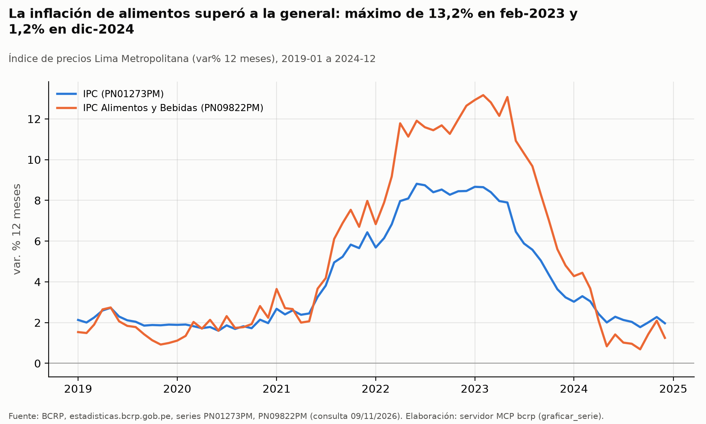
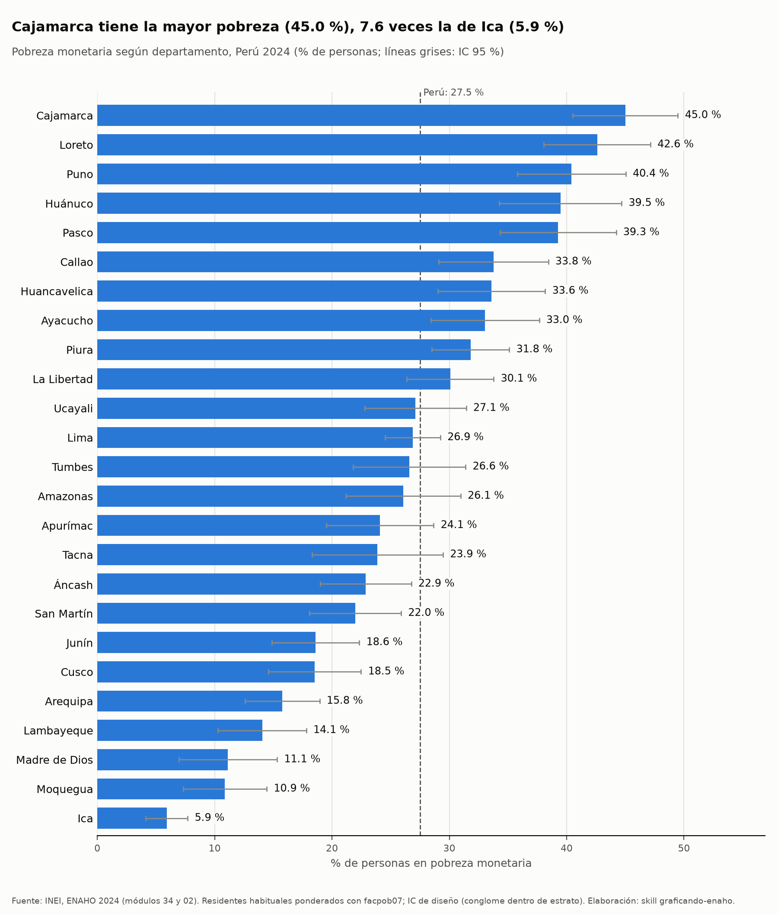
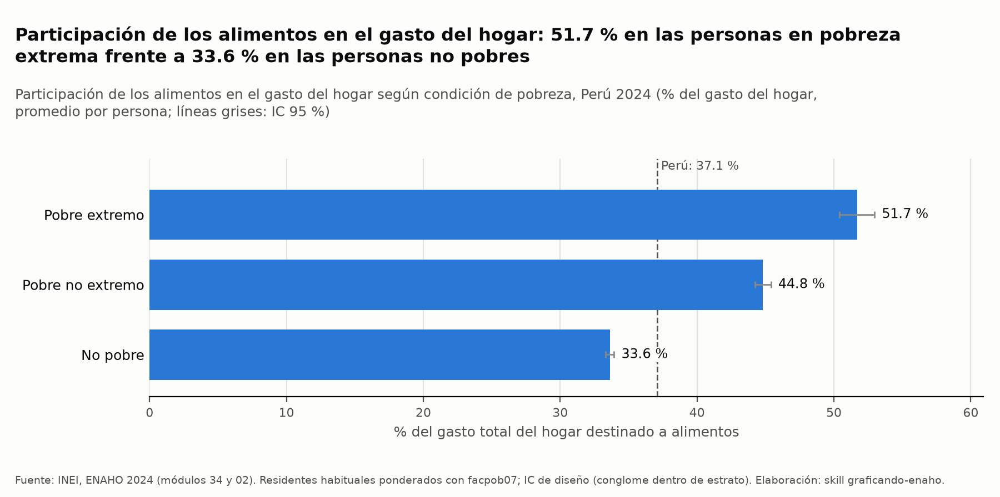
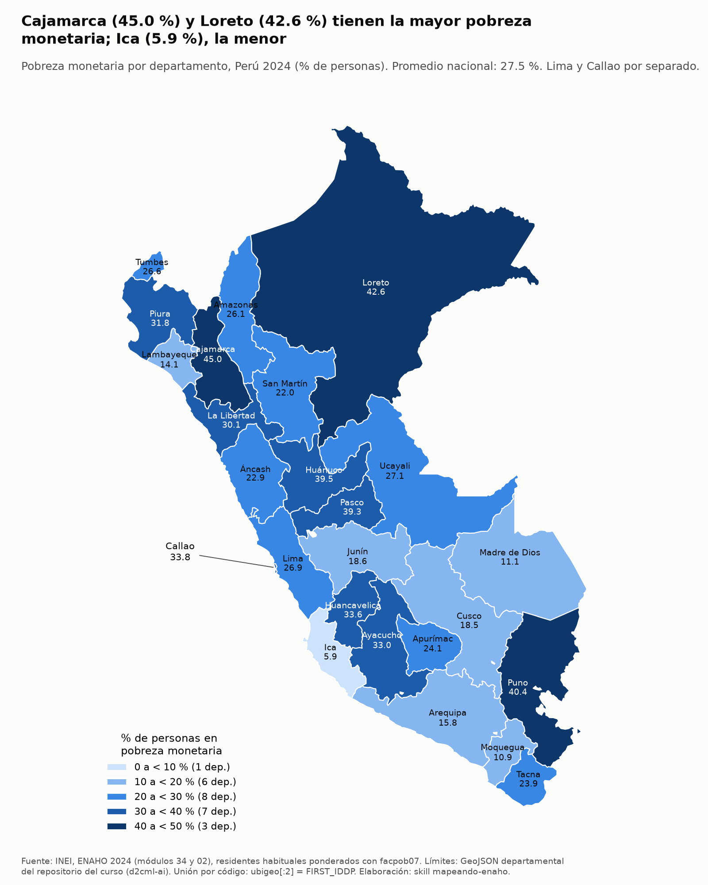

# Actividad, inflación y brechas de pobreza en el Perú, 2019–2024

## 1. Pregunta de investigación

**Tema.** Después de la recesión de 2020 y del pico inflacionario de 2022, ¿cómo evolucionaron la actividad económica y la inflación (en especial la de alimentos) y qué brechas territoriales y socioeconómicas de pobreza monetaria y de peso de los alimentos en el gasto mostraba el Perú en 2024?

**Objetivo.** Describir (i) la trayectoria 2019–2024 del PBI y de la inflación general y de alimentos, y (ii) un corte transversal 2024 de pobreza por área, región natural y departamento, y del peso de los alimentos en el gasto del hogar según condición de pobreza.

**Delimitación.**
- Períodos: BCRP, enero 2019 a diciembre 2024 (mensual y anual); ENAHO, año 2024.
- Cobertura geográfica: la inflación corresponde a **Lima Metropolitana**; la ENAHO cubre el **Perú nacional** (25 departamentos, con Lima y Callao separados).
- Unidades: variaciones porcentuales (anual o a 12 meses) para el BCRP; % de personas para la pobreza; % del gasto total del hogar para los alimentos.

## 2. Plan de análisis

1. BCRP: PBI real (variación anual y mensual interanual), IPC general y IPC de Alimentos y Bebidas (variación a 12 meses). Resumen, comparación de períodos y un gráfico.
2. ENAHO 2024: validar la base; pobreza por área, región natural y departamento; pobreza extrema por área; participación de los alimentos en el gasto por condición de pobreza y por área.
3. Un gráfico de la ENAHO por departamento, otro de alimentos por condición de pobreza, y el mapa departamental.
4. Contrastar con `salidas/validacion.txt` y `mapas/comparacion_referencia.txt`.

## 3. Fuentes y metodología

- **BCRP**, API de series estadísticas, consultada con el servidor MCP `bcrp`. Las cifras provienen de `resumen`, `serie` y `comparar_periodos`; no hice cuentas a mano.
- **INEI, ENAHO 2024** (código 966), módulo 34 (sumaria) y módulo 02 (miembros del hogar), procesados con las skills del proyecto.
- **Procesamiento** (`limpiar.py`): llaves leídas como texto, unión hogar–persona 1:m sin pérdida de filas, filtro de residentes habituales (108,664 personas; 33,691 hogares). Se pasaron 15 de 15 validaciones (`salidas/validacion.txt`: «Resultado: BASE VÁLIDA»).
- **Ponderación.** Las personas se ponderan con `facpob07`. Para comparar con la cifra oficial se usa el «método INEI» (sumaria, `factor07 × mieperho`). Sin ponderar, la pobreza nacional sería 25.61 %, un sesgo de −1.92 pp.
- **Indicadores.** Pobreza monetaria: % de personas en hogares pobres. Participación de alimentos: promedio, ponderado por personas, de la participación de los alimentos en el gasto del hogar. Por eso es un promedio entre personas y no entre hogares.
- **Intervalos.** Se reportan IC 95 %; si se superponen, la diferencia no es concluyente.

## 4. Resultados

**Hallazgo 1. Recesión en 2020, rebote en 2021, caída leve en 2023 y recuperación en 2024.**
- PBI real, variación anual (`PM04923AA`): 2019 = 2.2 %; 2020 = −10.9 %; 2021 = 13.4 %; 2022 = 2.8 %; 2023 = −0.4 %; 2024 = 3.5 %.
- PBI mensual interanual (`PN01728AM`, 2019-01 a 2024-12): mínimo de −39.3 % en 2020-04 y máximo de 59.9 % en 2021-04. El promedio de 2020 fue −10.9 % y diciembre de 2024 cerró en 5.1 %.

**Hallazgo 2. La inflación de alimentos fue más alta y duró más que la general.**
- IPC general de Lima Metropolitana, var. % 12 meses (`PN01273PM`, 2019-01 a 2024-12): máximo de 8.8 % en 2022-06, mínimo de 1.6 % en 2020-06 y 2.0 % en 2024-12. El promedio de 2022 fue 7.9 % y el de 2024, 2.4 %.
- IPC Alimentos y Bebidas (`PN09822PM`): promedio de 1.7 % en 2019, 10.8 % en 2022 y 2.0 % en 2024. El máximo fue **13.2 % en 2023-02**, posterior al pico de la inflación general; el mínimo, 0.7 % en 2024-09. Cerró 2024-12 en 1.2 %.
- Entre 2022 y 2024 el promedio de la inflación de alimentos bajó 8.8 pp (−81.3 %), y el de la general, 5.5 pp (−70.1 %) (`comparar_periodos`).

**Hallazgo 3. Brecha territorial de pobreza en 2024: rural, Sierra y departamentos del norte y del altiplano.**
- Nacional: 27.5 % (IC 26.5–28.6) con `facpob07`; 27.6 % con el método INEI (`salidas/validacion.txt`).
- Por área (`consultar.py --por area`): rural 39.4 % (IC 37.8–41.1) y urbana 24.7 % (IC 23.5–25.9). Los IC no se superponen. Pobreza extrema: rural 15.6 % y urbana 3.1 %.
- Por región natural: Costa 20.9 %, Lima Metropolitana 28.0 %, Selva 30.0 %, Sierra 31.1 %.
- Por departamento (`consultar.py --por departamento`): mayores Cajamarca 45.0 %, Loreto 42.6 %, Puno 40.4 %, Huánuco 39.5 % y Pasco 39.3 %. Menores Ica 5.9 %, Moquegua 10.9 %, Madre de Dios 11.1 %, Lambayeque 14.1 % y Arequipa 15.8 %. Los IC de Cajamarca (40.5–49.5) y de Loreto (38.1–47.2) se superponen, de modo que el orden entre ambos no es concluyente.

**Hallazgo 4. Los hogares más pobres destinan una mayor parte de su gasto a alimentos.**
- Participación de alimentos en el gasto (`consultar.py --media participacion_alimentos`): no pobres 33.6 % (IC 33.3–33.9), pobres no extremos 44.8 % (44.2–45.4), pobres extremos 51.7 % (50.4–53.0). Total: 37.1 %.
- Por área: rural 49.5 % y urbana 34.2 %.
- Los IC de los tres grupos no se superponen.

## 5. Visualizaciones

*Lectura:* ambas series suben desde 2021, la de alimentos queda por encima de la general y llega a 13.2 % en feb-2023, y las dos convergen cerca de 1–2 % a fines de 2024 (BCRP `PN01273PM`, `PN09822PM`).

*Lectura:* los departamentos se ordenan de 45.0 % (Cajamarca) a 5.9 % (Ica), con IC amplios (hasta ±5 pp) que hacen inconcluyentes muchas diferencias entre departamentos vecinos en el ranking.

*Lectura:* el peso de los alimentos en el gasto sube de 33.6 % (no pobres) a 51.7 % (pobres extremos).

*Lectura:* la pobreza se concentra en Cajamarca, Loreto, Puno, Huánuco y Pasco, y es mínima en Ica y en el sur costero.

## 6. Interpretación

- La actividad cayó fuerte en 2020, rebotó en 2021 y creció de forma moderada o débil después (2.8 %, −0.4 %, 3.5 %). La inflación de alimentos permaneció alta hasta inicios de 2023 y recién en 2024 volvió a niveles bajos.
- En 2024 la pobreza monetaria sigue marcada por brechas territoriales (rural frente a urbano, Sierra y Selva frente a Costa) y los hogares pobres gastan una proporción mayor de su presupuesto en alimentos.
- Estas son **asociaciones descriptivas**. Las series macro y la ENAHO 2024 no se cruzan en esta investigación. Que los hogares pobres dediquen más gasto a alimentos significa que un alza de precios de alimentos pesa más en su presupuesto, pero este informe no mide ese efecto ni afirma que la inflación o el PBI hayan causado la pobreza observada.

## 7. Limitaciones

- **Cobertura temporal.** La ENAHO es un único corte de 2024: no se observa la evolución de la pobreza desde 2019. Las series del BCRP cubren 2019–2024.
- **Niveles de agregación distintos.** El IPC corresponde a Lima Metropolitana; la pobreza, al país entero y a los departamentos. Una serie de tiempo no se puede cotejar directamente con un corte transversal.
- **Pobreza por departamento.** Las muestras departamentales dan IC de hasta ±5 pp; muchas diferencias entre departamentos no son concluyentes.
- **Definición de población.** Residentes habituales (`facpob07`) frente a miembros del hogar (`factor07 × mieperho`) difieren hasta 0.5 pp por departamento (ver sección 8).
- **Participación de alimentos.** Es un promedio entre personas de un indicador del hogar, no un promedio entre hogares.
- **Errores y contratiempos de herramientas durante la ejecución:**
  1. `salidas/validacion.txt` ya decía «BASE VÁLIDA», pero faltaba `salidas/personas_2024.parquet`, así que rehíce la limpieza con `limpiar.py`. Se resolvió y la validación volvió a dar 15 de 15 aprobadas.
  2. En el primer gráfico del BCRP escribí un título que ubicaba el máximo de la inflación de alimentos en 2022, pero la serie lo marca en 2023-02. Lo regeneré con un título correcto y el mismo nombre de archivo, que sobrescribió al primero.
  3. Dos llamadas a Bash con una variable de shell fueron rechazadas («A variable in this command can't be checked before it runs»). Las repetí sin variables.
  4. Al inicio, el control de versiones mostraba como borrados varios archivos antiguos de `figuras/` y `mapas/`; los regeneré con las skills y no los restauré.
- **Alcance.** No se estimaron efectos ni causas.

## 8. Reproducibilidad

**Contraste con cifras oficiales y con la referencia del curso.**
- `salidas/validacion.txt`: pobreza nacional 27.53 % (residentes habituales) y 27.58 % (método INEI) frente a 27.6 % oficial; extrema 5.50 % frente a 5.5 %; urbana 24.81 % (INEI) / 24.74 % frente a 24.8 %; rural 39.30 % (INEI) / 39.44 % frente a 39.3 %; Lima Metropolitana 28.21 % / 28.03 % frente a 28.2 %. Las cifras coinciden dentro de las tolerancias; las diferencias de unas décimas vienen de la definición de población.
- `mapas/comparacion_referencia.txt`: con el método INEI coinciden los 25 departamentos (diferencia máxima 0.0 pp). Con residentes habituales coinciden 6 de 25, con diferencia máxima de 0.5 pp (Amazonas, Huánuco, Loreto, Pasco, Puno y Tumbes con ≥ 0.3 pp) y correlación de rangos de 0.999. El orden de los departamentos se mantiene; la causa es la población de referencia (residentes habituales frente a miembros del hogar con `mieperho`). Las cifras de este informe usan residentes habituales, salvo que se indique lo contrario.

**Comandos** (desde `tarea_4/`, con `uv run python`):
- `.claude/skills/limpiando-enaho/scripts/limpiar.py --anio 2024`
- `.claude/skills/limpiando-enaho/scripts/consultar.py --por area | --por departamento --orden desc | --por region_natural | --por area --indicador pobre_extremo | --media participacion_alimentos --por condicion_pobreza | --media participacion_alimentos --por area`
- `.claude/skills/graficando-enaho/scripts/graficar.py --por departamento` y `--indicador participacion_alimentos --por condicion_pobreza`
- `.claude/skills/mapeando-enaho/scripts/mapear.py`

**Series BCRP:** `PM04923AA` (PBI real, var. % anual), `PN01728AM` (PBI, var. % interanual mensual), `PN01273PM` (IPC Lima Metropolitana, var. % 12 meses), `PN09822PM` (IPC Alimentos y Bebidas, var. % 12 meses).

**Archivos:** `salidas/personas_2024.parquet`, `salidas/hogares_2024.parquet`, `salidas/indicadores.csv`, `salidas/validacion.txt`, `figuras/bcrp_inflacion_2019_2024.png`, `figuras/pobreza_departamento.{png,csv}`, `figuras/participacion_alimentos_condicion_pobreza.{png,csv}`, `mapas/pobreza_departamento_2024.{png,csv}`, `mapas/comparacion_referencia.{csv,txt}`.

## 9. Registro de herramientas

| Herramienta | Uso |
|---|---|
| Recurso MCP `bcrp://series-clave` | Identificar códigos de series clave |
| MCP `bcrp` · `buscar_series` | Confirmar códigos de IPC de alimentos y PBI mensual |
| MCP `bcrp` · `serie` | Datos anuales del PBI (`PM04923AA`) |
| MCP `bcrp` · `resumen` | Extremos, promedios y últimos valores de `PN01273PM`, `PN09822PM`, `PN01728AM` |
| MCP `bcrp` · `comparar_periodos` | 2019 frente a 2022 y 2022 frente a 2024 en la inflación |
| MCP `bcrp` · `graficar_serie` | Gráfico de inflación general y de alimentos |
| Skill `limpiando-enaho` | Validar la base y obtener cifras ponderadas |
| Skill `graficando-enaho` | Gráficos por departamento y por condición de pobreza |
| Skill `mapeando-enaho` | Mapa departamental y comparación con la referencia |

---

*Nota añadida después de la ejecución del agente.* Las secciones 1 a 9 son del agente: se generaron en la ejecución integrada registrada en `evidencias_ia/integracion/02_ejecucion_integrada.md`. Después se verificaron a mano 15 cifras de este informe (6 del BCRP y 9 de la ENAHO), recalculadas sin el MCP ni las skills y, en el caso del BCRP, cotejadas también en la web de BCRPData. Coinciden todas. El detalle está en [`verificacion.md`](verificacion.md).
